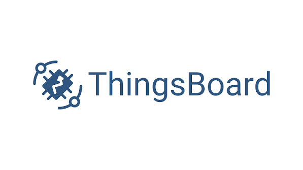
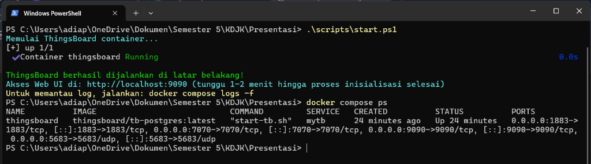
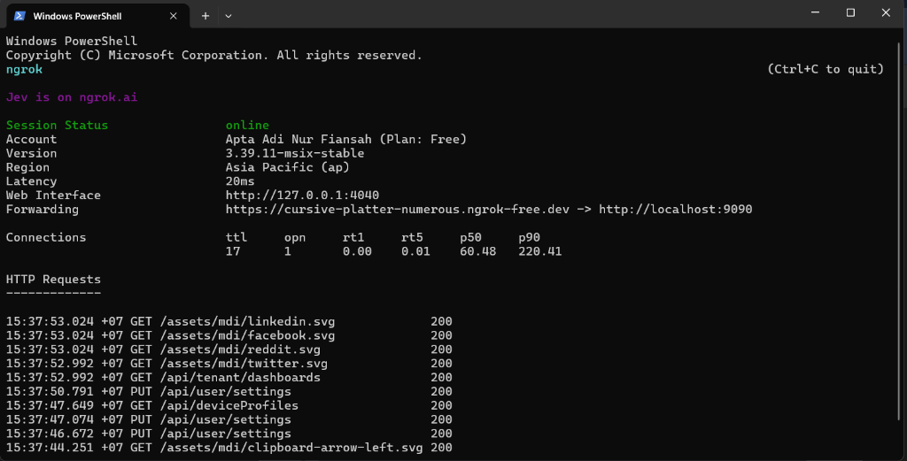
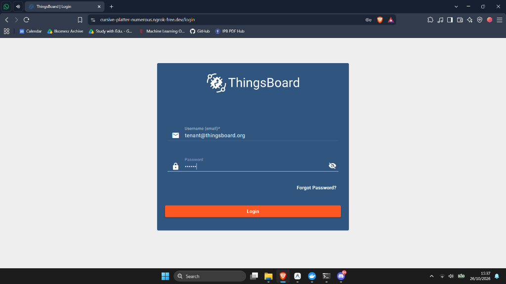
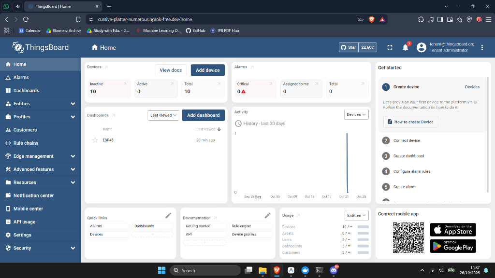
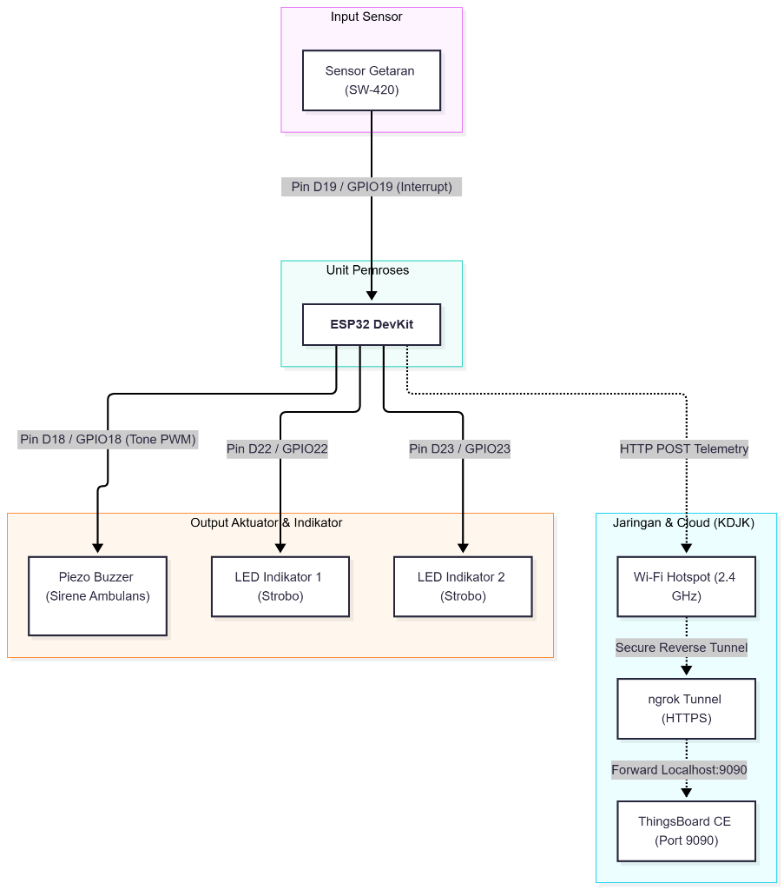
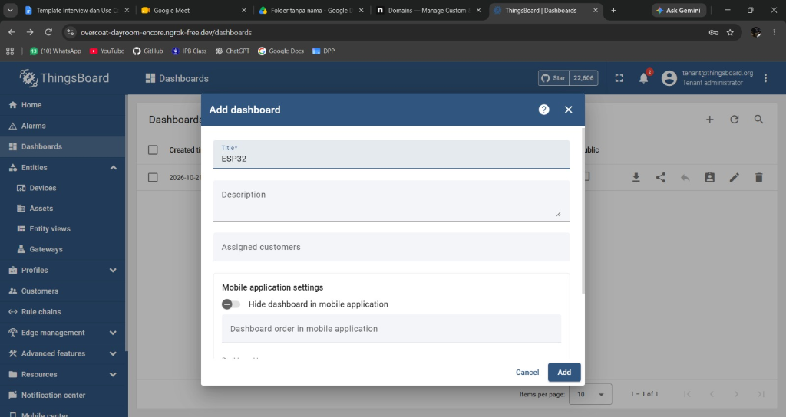
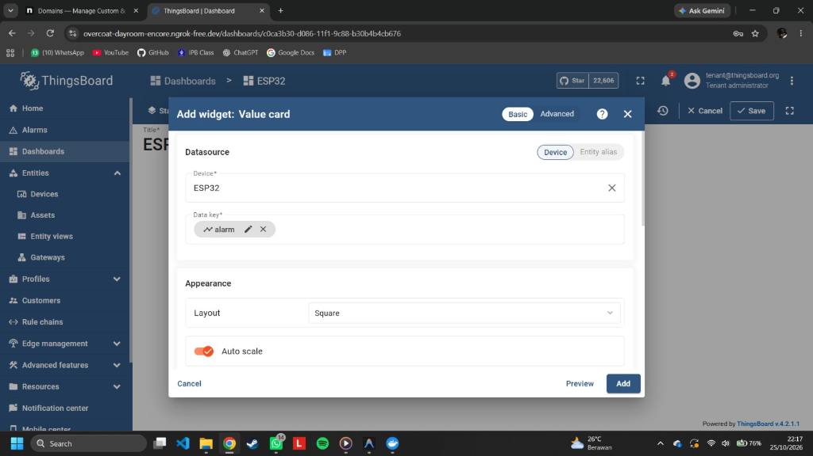
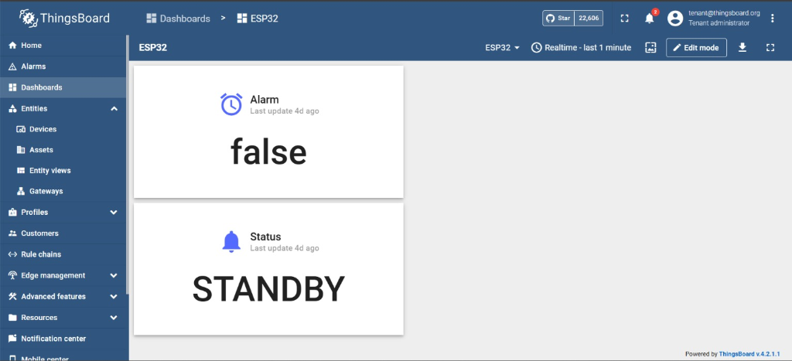

<h1 align="center">
  
</h1>

<div align="center">
  <h1>ThingsBoard</h1>
  <p>Projek Akhir Praktikum Komunikasi Data dan Jaringan Komputer (KDJK)</p>
  <p>Disusun oleh:</p>
  <table align="center" style="margin-top: 1rem; text-align: left; border-collapse: collapse;">
    <tr>
      <th style="padding: 6px 16px; border-bottom: 2px solid #ccc;">Nama</th>
      <th style="padding: 6px 16px; border-bottom: 2px solid #ccc;">NIM</th>
    </tr>
    <tr>
      <td style="padding: 6px 16px; font-weight: bold;">Apta Adi Nur Fiansah</td>
      <td style="padding: 6px 16px;">M0403241003</td>
    </tr>
    <tr>
      <td style="padding: 6px 16px; font-weight: bold;">Candra Agung Alief Prasetyo</td>
      <td style="padding: 6px 16px;">M0403241006</td>
    </tr>
    <tr>
      <td style="padding: 6px 16px; font-weight: bold;">Muhammad Hikmal Fadhil Agis</td>
      <td style="padding: 6px 16px;">M0403241014</td>
    </tr>
    <tr>
      <td style="padding: 6px 16px; font-weight: bold;">Muhammad Farrel Alfachrezi</td>
      <td style="padding: 6px 16px;">M0403241015</td>
    </tr>
    <tr>
      <td style="padding: 6px 16px; font-weight: bold;">Raihanah Azka Zhafira</td>
      <td style="padding: 6px 16px;">M0403241016</td>
    </tr>
  </table>
  <br>
</div>

<div align="center">

[Sekilas Tentang](#sekilas-tentang) | [Instalasi](#instalasi) | [Konfigurasi](#konfigurasi) | [Maintenance](#maintenance) | [Otomatisasi](#otomatisasi) | [Cara Pemakaian](#cara-pemakaian) | [Pembahasan](#pembahasan) | [Referensi](#referensi)

</div>

---

# Sekilas Tentang
[`^ kembali ke atas ^`](#)

**ThingsBoard** adalah platform IoT (*Internet of Things*) *open-source* berbasis web yang digunakan untuk pengumpulan data telemetri, pemrosesan dan visualisasi data, serta manajemen perangkat (*device management*) secara terpusat. Dikembangkan oleh ThingsBoard, Inc., platform ini dirancang dengan skalabilitas tinggi serta mendukung model *multi-tenancy* sehingga siap digunakan dari skala eksperimen laboratorium hingga kebutuhan *smart city* dan industri (*Industrial IoT*).

---

# Instalasi
[`^ kembali ke atas ^`](#)

#### Kebutuhan Sistem :
- **Sistem Operasi:** Windows 10/11 (64-bit) dengan Docker Desktop, atau Linux (Ubuntu 20.04/22.04/24.04 LTS).
- **Virtualisasi:** WSL 2 (Windows Subsystem for Linux) atau Hyper-V aktif.
- **Hardware:**
  - RAM minimal 4 GB dialokasikan untuk Docker (disarankan total RAM fisik 8–16 GB).
  - CPU minimal 2 Cores.
  - Sisa ruang penyimpanan (*Disk Space*) minimal 10 GB.
- **Software Pendukung:**
  - [Docker Engine & Docker Compose](https://www.docker.com/products/docker-desktop/) (v20+).
  - [ngrok](https://ngrok.com/) (v3+).
  - Web Browser modern (Google Chrome, Firefox, Microsoft Edge).

#### Langkah Instalasi CLI :

1. **Pastikan Docker Desktop Berjalan**  
   Buka aplikasi Docker Desktop di komputer Anda dan pastikan status di sudut kiri bawah berwarna hijau (**Engine running**).

2. **Kloning Repositori Projek**  
   Buka terminal (PowerShell atau Git Bash) lalu kloning repositori projek:
   ```bash
   git clone https://github.com/farrelachr/thingsboard-kdjk.git
   cd thingsboard-kdjk
   ```

3. **Siapkan File Variabel Lingkungan (`.env`)**  
   Salin template `.env.example` menjadi `.env` untuk mengatur konfigurasi port dan alokasi memori JVM:
   ```powershell
   Copy-Item .env.example .env
   ```
   *Isi default `.env`:*
   ```env
   TB_HTTP_PORT=9090
   TB_MQTT_PORT=1883
   TB_COAP_PORT=5683
   TB_EDGE_PORT=7070
   JAVA_OPTS=-Xms1024M -Xmx2048M
   ```

4. **Jalankan Container Menggunakan Skrip Otomasi / Docker Compose**  
   Jalankan skrip `start.ps1` untuk menyalakan container ThingsBoard di latar belakang (*detached mode*), lalu verifikasi statusnya menggunakan `docker compose ps`:
   ```powershell
   .\scripts\start.ps1
   docker compose ps
   ```
   *(Atau bisa juga menggunakan perintah langsung: `docker compose up -d`)*.

<p align="center">
  
</p>

5. **Pantau Proses Inisialisasi (*Cold Start*)**  
   Pada saat pertama kali dijalankan, ThingsBoard akan menginisialisasi skema basis data PostgreSQL dan data demo. Proses ini memerlukan waktu 1–2 menit:
   ```bash
   docker compose logs -f
   ```
   Tunggu hingga muncul log:  
   `Started ThingsboardServerApplication in ... seconds`  
   *(Tekan `Ctrl + C` untuk keluar dari pemantauan log).*

6. **Pengujian Akses Web UI Lokal**  
   Buka browser dan akses alamat berikut:
   ```text
   http://localhost:9090
   ```
   Jika halaman login ThingsBoard berhasil terbuka, maka proses instalasi lokal telah sukses.

7. **Menghubungkan ke ngrok Tunnel (Akses Publik)**  
   Agar ThingsBoard dapat diakses oleh dosen/asisten lab dari luar jaringan lokal (tanpa satu WiFi), hubungkan authtoken dan jalankan ngrok:
   ```powershell
   # Jalankan tunneling ke port 9090
   ngrok http 9090
   ```

<p align="center">
  
</p>

---

# Konfigurasi
[`^ kembali ke atas ^`](#)

### 1. Pembatasan Memori (JVM Heap Size)
Karena ThingsBoard dibangun menggunakan framework Java Spring Boot, alokasi memori JVM (*Java Virtual Machine*) perlu dibatasi agar container tidak mengalami *Out of Memory* (OOM) atau membebani sistem operasi host.

Pengaturan dilakukan melalui parameter `JAVA_OPTS` di file `.env` atau `docker-compose.yml`:
```yaml
environment:
  JAVA_OPTS: "-Xms1024M -Xmx2048M -XX:+ExitOnOutOfMemoryError"
```
- `-Xms1024M`: Alokasi memori awal saat startup sebesar 1 GB.
- `-Xmx2048M`: Batas maksimum penggunaan memori heap sebesar 2 GB.
- `-XX:+ExitOnOutOfMemoryError`: Memaksa container restart otomatis jika terjadi error memori agar sistem tidak *hang*.

### 2. Kustomisasi Port Jaringan
Untuk menghindari bentrok (*conflict*) dengan layanan lokal lain (seperti web server default port 8080), port Web UI ThingsBoard dialihkan ke port **9090**:
| Port Host | Port Container | Protokol | Keterangan |
| :--- | :--- | :--- | :--- |
| **9090** | 9090 | TCP (HTTP) | Antarmuka Web Dashboard & REST API Ingestion |
| **1883** | 1883 | TCP (MQTT) | Jalur pengiriman data sensor telemetri perangkat |
| **5683** | 5683 | UDP (CoAP) | Protokol CoAP untuk mikrokontroler daya rendah |
| **7070** | 7070 | TCP (gRPC) | ThingsBoard Edge RPC Communication |

### 3. Konfigurasi Akun Pengguna (*Tenant Administrator*)
Setelah instalasi pertama, ThingsBoard menyediakan akun kerja utama (**Tenant Administrator**) untuk mengelola seluruh ekosistem perangkat dan visualisasi:
- **Username:** `tenant@thingsboard.org`
- **Password:** `tenant`

> *Catatan Keamanan: Sangat disarankan mengubah kata sandi default melalui menu **Profile Settings** segera setelah login pertama kali.*

---

# Maintenance
[`^ kembali ke atas ^`](#)

ThingsBoard menggunakan PostgreSQL sebagai basis data relasional untuk metadata dan penyimpanan time-series. Pemeliharaan rutin dilakukan guna mencegah kehilangan data dan mencegah disk penuh akibat penumpukan log.

### 1. Pencadangan Basis Data (*Database Backup*) Mingguan
Untuk mencadangkan seluruh skema dan data tabel ThingsBoard, gunakan utilitas `pg_dump` langsung dari dalam container database:

Buat skrip backup `backup-thingsboard.ps1`:
```powershell
$Timestamp = Get-Date -Format "yyyy-MM-dd_HH-mm"
$BackupDir = ".\backups"
if (!(Test-Path $BackupDir)) { New-Item -ItemType Directory -Path $BackupDir }

# Eksekusi pg_dump dari dalam container thingsboard
docker exec -t thingsboard pg_dump -U postgres -d thingsboard > "$BackupDir\tb_backup_$Timestamp.sql"

# Hapus backup yang lebih lama dari 14 hari
Get-ChildItem $BackupDir -Filter *.sql | Where-Object { $_.LastWriteTime -lt (Get-Date).AddDays(-14) } | Remove-Item
Write-Host "Pencadangan basis data ThingsBoard berhasil: tb_backup_$Timestamp.sql"
```

Untuk menjadwalkan secara otomatis setiap hari Minggu pukul 02.00 WIB pada Windows, jalankan perintah Task Scheduler:
```powershell
schtasks /create /tn "ThingsBoard_Weekly_Backup" /tr "powershell.exe -File C:\path\to\backup-thingsboard.ps1" /sc weekly /d SUN /st 02:00
```

### 2. Pemulihan Data (*Database Restore*)
Jika terjadi kegagalan sistem, data dapat dipulihkan dengan memasukkan file backup SQL ke container:
```bash
cat ./backups/tb_backup_2026-10-16.sql | docker exec -i thingsboard psql -U postgres -d thingsboard
```

### 3. Pembersihan Log & Pengurangan Volume Disk
ThingsBoard menghasilkan file log sistem di `/var/log/thingsboard`. Untuk membersihkan log Docker yang membengkak:
```powershell
# Bersihkan log container tanpa mematikan container
Clear-Content (docker inspect --format='{{.LogPath}}' thingsboard)

# Hapus build cache yang tidak terpakai
docker system prune -f
```

---

# Otomatisasi
[`^ kembali ke atas ^`](#)

Untuk memudahkan operasional tanpa perlu mengetikkan perintah panjang berulang kali, telah disediakan serangkaian skrip otomatisasi PowerShell di dalam folder `scripts/`:

### 1. Menjalankan Layanan (`scripts/start.ps1`)
Skrip ini memeriksa kesiapan Docker Desktop, membaca variabel `.env`, dan menginisialisasi container secara otomatis:
```powershell
.\scripts\start.ps1
```
*Isi perintah skrip:*
```powershell
Write-Host "[ThingsBoard] Menjalankan container via Docker Compose..." -ForegroundColor Cyan
docker compose up -d
Write-Host "[ThingsBoard] Berhasil dijalankan! Buka browser di http://localhost:9090" -ForegroundColor Green
```

### 2. Menjalankan ngrok Tunnel Otomatis (`scripts/ngrok.ps1`)
Skrip ini menjalankan tunneling ngrok secara otomatis ke port 9090, dengan opsi menyimpan authtoken:
```powershell
# Jalankan pertama kali (sekaligus menyimpan token):
.\scripts\ngrok.ps1 -Authtoken "TOKEN_NGROK_ANDA"

# Untuk pemakaian selanjutnya:
.\scripts\ngrok.ps1
```

### 3. Menghentikan Layanan (`scripts/stop.ps1`)
Menghentikan container ThingsBoard dan proses tunneling ngrok secara otomatis:
```powershell
.\scripts\stop.ps1
```
*Isi perintah skrip:*
```powershell
Write-Host "Menghentikan ThingsBoard container..." -ForegroundColor Yellow
docker compose down

# Hentikan proses ngrok jika sedang berjalan
$ngrokProc = Get-Process ngrok -ErrorAction SilentlyContinue
if ($ngrokProc) {
    Stop-Process -Name ngrok -Force -ErrorAction SilentlyContinue
    Write-Host "ngrok berhasil dihentikan." -ForegroundColor Green
}
```

---

# Cara Pemakaian
[`^ kembali ke atas ^`](#)

Berikut adalah panduan operasional lengkap dari proses login, pendaftaran sensor, pengiriman telemetri, pembuatan dashboard visual, hingga pengujian alarm.

### 1. Login ke Halaman Web
1. Buka URL ThingsBoard (misal: `http://localhost:9090` atau URL publik ngrok `https://cursive-platter-numerous.ngrok-free.dev`).
2. Masukkan kredensial akun Tenant Administrator:
   - **Username:** `tenant@thingsboard.org`
   - **Password:** `tenant`
3. Klik tombol **Login**.

<p align="center">
  
</p>

### 2. Mengenal Tampilan Antarmuka
Setelah login, antarmuka dashboard utama akan menampilkan beberapa menu di bilah kiri (*sidebar*):
| Menu | Fungsi Utama |
| :--- | :--- |
| **Device Groups / Devices** | Mendaftarkan sensor/perangkat IoT dan mengelola Access Token kredensial |
| **Dashboards** | Membuat antarmuka visual grafik, gauge status, peta GPS, dan panel kendali |
| **Rule Chains** | Memprogram alur logika data, pemfilteran pesan, dan pemicu alarm (*Rule Engine*) |
| **Alarms** | Meninjau riwayat alarm aktif dan konfirmasi penyelesaian masalah (*Acknowledge/Clear*) |
| **Customers** | Mengelompokkan hak akses dashboard untuk pengguna/klien tertentu |

<p align="center">
  
</p>

### 3. Mendaftarkan Perangkat (*Device*) & Mendapatkan Access Token
1. Buka menu **Device Groups** $\rightarrow$ klik grup **All** $\rightarrow$ klik ikon **`+`** (Add device) $\rightarrow$ pilih **Add new device**.
2. Masukkan nama perangkat, misalnya: `ESP32-Vibration-Detector`.
3. Biarkan jenis transport default (**Default**).
4. Klik tombol **Add**.
5. Buka perangkat yang baru dibuat, masuk ke tab **Details** $\rightarrow$ klik **Copy Access Token** (simpan token ini, misalnya: `ergr5lzZUIgBE10w356F`).

---

### 4. Implementasi Hardware ESP32 & Pengiriman Data Telemetri
Projek ini mengintegrasikan perangkat keras mikrokontroler **ESP32 DevKit** dengan sensor getaran fisik, aktuator suara sirene, dan lampu indikator strobo.

<p align="center">
  
</p>

#### Tabel Konfigurasi Pin Hardware:
| Komponen | Pin ESP32 | Mode Pin | Keterangan Fungsi |
| :--- | :--- | :--- | :--- |
| **Sensor Getaran SW-420** | **D19** (GPIO 19) | `INPUT_PULLUP` | Menangkap getaran fisik secara instan menggunakan Hardware Interrupt (`CHANGE`) |
| **Piezoelectric Buzzer** | **D18** (GPIO 18) | `OUTPUT` | Menghasilkan sirene ambulans dua nada frekuensi (960 Hz & 770 Hz) saat getaran terdeteksi |
| **LED Indikator 1** | **D22** (GPIO 22) | `OUTPUT` | Lampu strobo indikator alarm aktif (berkedip bergantian dengan LED 2) |
| **LED Indikator 2** | **D23** (GPIO 23) | `OUTPUT` | Lampu strobo indikator alarm aktif |

#### Struktur Data Telemetri (JSON):
Setiap kali getaran terdeteksi atau status berkala dikirimkan, ESP32 mengirim payload HTTP POST dalam format JSON:
```json
{
  "vibration": true,
  "alarm_status": "CRITICAL",
  "vibration_count": 1,
  "message": "Getaran Terdeteksi!"
}
```

#### Metode 1: Pengujian Langsung Hardware ESP32 Fisik (Metode Utama)
Kode program mikrokontroler lengkap tersedia di [`examples/esp32_demo/esp32_demo.ino`](./examples/esp32_demo/esp32_demo.ino):
1. **Langkah Pengujian:**
   - Nyalakan ESP32 (sambungkan kabel USB ke laptop atau sumber daya). Saat menyala, ESP32 melakukan *hardware self-test* (buzzer BEEP 0.5 detik dan kedua LED menyala singkat).
   - Pastikan Hotspot Wi-Fi aktif agar ESP32 terhubung ke internet.
   - **Goyangkan atau sentil sensor getaran (SW-420 pada Pin D19):**
     - **Aktuator Lokal:** Buzzer (Pin D18) langsung membunyikan sirene ambulans dua nada (960 Hz & 770 Hz) dan LED strobo (D22 & D23) berkedip bergantian selama 2 detik.
     - **Telemetri Cloud:** ESP32 secara instan mengirimkan data JSON ke server ThingsBoard melalui tunnel ngrok HTTPS.
2. **Fitur Fail-Safe:** Menggunakan model koneksi *non-blocking*, sehingga alarm fisik (suara sirene & lampu strobo) tetap berbunyi seketika walaupun koneksi internet sedang terputus.

---

#### Metode 2: Simulasi Telemetri via cURL (Pengujian Tanpa Hardware Fisik)
Jika perangkat ESP32 sedang *offline* atau tidak berada di tempat, transmisi data telemetri dan pemicu alarm di ThingsBoard tetap dapat disimulasikan melalui terminal menggunakan protokol HTTP REST API:

```bash
# Pengujian Lokal
curl -v -X POST http://localhost:9090/api/v1/ergr5lzZUIgBE10w356F/telemetry \
  --header "Content-Type:application/json" \
  --data "{\"vibration\": true, \"alarm_status\": \"CRITICAL\", \"vibration_count\": 1, \"message\": \"Getaran Terdeteksi!\"}"
```
*Atau melalui ngrok Tunnel publik (HTTPS):*
```bash
curl -v -X POST https://cursive-platter-numerous.ngrok-free.dev/api/v1/ergr5lzZUIgBE10w356F/telemetry \
  --header "Content-Type:application/json" \
  --data "{\"vibration\": true, \"alarm_status\": \"CRITICAL\", \"vibration_count\": 1, \"message\": \"Getaran Terdeteksi!\"}"
```

---

### 5. Membangun Dashboard Visualisasi Interaktif
1. Buka menu **Dashboards** $\rightarrow$ klik ikon **`+`** $\rightarrow$ **Create new dashboard**.
2. Masukkan nama dashboard, misalnya: `ESP32` (atau `Sistem Deteksi Getaran ESP32`) lalu klik tombol **Add**.

<p align="center">
  
</p>

3. Buka dashboard yang baru dibuat, masuk ke mode edit (ikon pensil), lalu pilih **Add new widget**.
4. Pilih tipe widget **Cards / Value card** untuk menampilkan indikator realtime:
   - Pilih Datasource: **Device** $\rightarrow$ Perangkat: `ESP32`.
   - Pilih Data key telemetri: `alarm` (atau `alarm_status`).
   - Atur tampilan *Appearance Layout* (misal: *Square*) lalu klik **Add**.

<p align="center">
  
</p>

5. Tambahkan widget pendukung lainnya seperti kartu **Status Operasional** (`STANDBY` / `ACTIVE`) atau grafik timeseries getaran.
6. Simpan dashboard (klik centang kuning di pojok kanan bawah). Dashboard monitoring interaktif siap digunakan secara *real-time*:

<p align="center">
  
</p>

---

### 6. Menguji Alarm Otomatis (*Rule Engine*)
1. Secara default, sistem ThingsBoard memproses telemetri melalui `Root Rule Chain`.
2. Ketika sensor mendeteksi getaran (`vibration: true` atau `alarm_status: "CRITICAL"`):
   - ThingsBoard secara otomatis mencatat *event* dan memicu status **Alarm Severity: CRITICAL**.
   - Widget tabel alarm di dashboard akan berkedip merah secara *real-time* menandakan adanya anomali fisik.
3. Saat kondisi stabil kembali (`alarm_status: "NORMAL"`), sistem dapat membersihkan status alarm (*Clear Alarm*).

---

# Pembahasan
[`^ kembali ke atas ^`](#)

### Analisis Aplikasi ThingsBoard

#### 1. Kelebihan
- **Protokol Standar Komunikasi Data Lengkap:** Mendukung MQTT, HTTP, dan CoAP secara *native* tanpa perlu instalasi broker perantara pihak ketiga. Sangat ideal untuk praktikum Komunikasi Data dan Jaringan Komputer.
- **Visualisasi & Dashboard Kaya Fitur:** Menyediakan puluhan widget siap pakai (gauge, peta GPS, grafik *time-series*, tombol kendali relay balik/RPC) dengan konfigurasi visual *drag-and-drop*.
- **Rule Engine Berbasis Graf Visual:** Logika otomasi, penyaringan anomali, kalkulasi telemetri, dan pemicu notifikasi alarm dapat dirancang dengan menghubungkan *node graph* tanpa perlu melakukan *re-compile* kode backend.
- **Dukungan Multi-Tenancy:** Arsitektur yang memisahkan hak akses antara Administrator Sistem, Pemilik Tenant, dan Pengguna Pelanggan (*Customer*) secara aman dan terisolasi.
- **Skalabilitas Deployment:** Berkat arsitektur berbasis container dan microservices, ThingsBoard dapat dijalankan secara monolitik di laptop lokal maupun dikembangkan menjadi klaster berkapasitas jutaan perangkat dengan Kafka dan Cassandra.

#### 2. Kekurangan
- **Konsumsi Sumber Daya Memori Relatif Tinggi:** Karena dibangun di atas JVM (Java Virtual Machine) dan Spring Boot, ThingsBoard membutuhkan RAM minimal 2–4 GB agar berjalan stabil, lebih berat dibandingkan aplikasi berbasis Go atau C++.
- **Kurva Pembelajaran Awal (*Learning Curve*):** Konsep abstrak seperti *Device Profiles*, *Asset Groups*, *Entity Aliases*, dan *Rule Chains* memerlukan pemahaman konseptual yang cukup mendalam bagi pemula.
- **Waktu Startup (*Cold Start*) Lambat:** Memerlukan waktu antara 60 hingga 120 detik saat pertama kali container dinyalakan untuk memuat dependensi Java dan inisialisasi tabel basis data.

---

### Perbandingan dengan Aplikasi Web Sejenis

Untuk memenuhi agenda evaluasi pada projek praktikum KDJK, berikut adalah perbandingan ThingsBoard dengan platform IoT sejenis (**Blynk (blynk.io)** dan **ThingSpeak**):

<section align="center">
  <table align="center" style="margin-top: 1rem; text-align: left; border-collapse: collapse; font-size: 0.95em;">
    <thead>
      <tr style="background-color: rgba(0, 0, 0, 0.05);">
        <th style="padding: 8px 14px; border: 1px solid #ddd;">Aspek Evaluasi</th>
        <th style="padding: 8px 14px; border: 1px solid #ddd;">ThingsBoard (CE)</th>
        <th style="padding: 8px 14px; border: 1px solid #ddd;">Blynk (blynk.io)</th>
        <th style="padding: 8px 14px; border: 1px solid #ddd;">ThingSpeak</th>
      </tr>
    </thead>
    <tbody>
      <tr>
        <td style="padding: 8px 14px; font-weight: bold; border: 1px solid #ddd;">Pengembang Utama</td>
        <td style="padding: 8px 14px; border: 1px solid #ddd;">ThingsBoard, Inc.</td>
        <td style="padding: 8px 14px; border: 1px solid #ddd;">Blynk Inc.</td>
        <td style="padding: 8px 14px; border: 1px solid #ddd;">The MathWorks, Inc.</td>
      </tr>
      <tr>
        <td style="padding: 8px 14px; font-weight: bold; border: 1px solid #ddd;">Target & Fokus Utama</td>
        <td style="padding: 8px 14px; border: 1px solid #ddd;">Industrial IoT (IIoT), Smart City, Telemetri Industri Skala Besar</td>
        <td style="padding: 8px 14px; border: 1px solid #ddd;">Prototyping Cepat, Mobile IoT Apps (iOS/Android), Smart Devices</td>
        <td style="padding: 8px 14px; border: 1px solid #ddd;">Akademis, Riset Ilmiah, Integrasi Analisis MATLAB</td>
      </tr>
      <tr>
        <td style="padding: 8px 14px; font-weight: bold; border: 1px solid #ddd;">Model Deployment</td>
        <td style="padding: 8px 14px; border: 1px solid #ddd;">Self-hosted Penuh (Docker, Bare-metal) & Cloud</td>
        <td style="padding: 8px 14px; border: 1px solid #ddd;">Cloud SaaS (Blynk Cloud) & Self-hosted terbatas (Legacy)</td>
        <td style="padding: 8px 14px; border: 1px solid #ddd;">Cloud-hosted SaaS (versi self-hosted sangat terbatas)</td>
      </tr>
      <tr>
        <td style="padding: 8px 14px; font-weight: bold; border: 1px solid #ddd;">Dukungan Protokol Jaringan</td>
        <td style="padding: 8px 14px; border: 1px solid #ddd;">MQTT, HTTP/HTTPS, CoAP, LwM2M, SNMP (Native)</td>
        <td style="padding: 8px 14px; border: 1px solid #ddd;">Blynk Protocol (TCP/SSL), HTTP REST API, MQTT</td>
        <td style="padding: 8px 14px; border: 1px solid #ddd;">HTTP REST, MQTT</td>
      </tr>
      <tr>
        <td style="padding: 8px 14px; font-weight: bold; border: 1px solid #ddd;">Antarmuka & Visualisasi</td>
        <td style="padding: 8px 14px; border: 1px solid #ddd;">Web Dashboard interaktif kaya widget kustom (Desktop & Mobile Browser)</td>
        <td style="padding: 8px 14px; border: 1px solid #ddd;">Sangat kuat di Mobile App Native (iOS/Android) + Web Console</td>
        <td style="padding: 8px 14px; border: 1px solid #ddd;">Web Dashboard standar berbasis grafik visual MATLAB</td>
      </tr>
      <tr>
        <td style="padding: 8px 14px; font-weight: bold; border: 1px solid #ddd;">Mesin Otomasi (*Rules*)</td>
        <td style="padding: 8px 14px; border: 1px solid #ddd;">Rule Chain visual berbasis <i>node flow graph</i> yang sangat kompleks</td>
        <td style="padding: 8px 14px; border: 1px solid #ddd;">Event & Automations berbasis kondisi Trigger-Action (Push/Email)</td>
        <td style="padding: 8px 14px; border: 1px solid #ddd;">Analisis komputasi numerik & skrip berbasis MATLAB</td>
      </tr>
      <tr>
        <td style="padding: 8px 14px; font-weight: bold; border: 1px solid #ddd;">Multi-Tenancy</td>
        <td style="padding: 8px 14px; border: 1px solid #ddd;"><b>Mendukung penuh</b> (System Admin, Tenant, Customer)</td>
        <td style="padding: 8px 14px; border: 1px solid #ddd;">Tersedia pada plan Business (Organizations / Multi-tier)</td>
        <td style="padding: 8px 14px; border: 1px solid #ddd;">Tidak ada (arsitektur berbasis per-channel)</td>
      </tr>
      <tr>
        <td style="padding: 8px 14px; font-weight: bold; border: 1px solid #ddd;">Kebutuhan RAM Server</td>
        <td style="padding: 8px 14px; border: 1px solid #ddd;">2 GB – 4 GB (relatif berat karena Java/Postgres)</td>
        <td style="padding: 8px 14px; border: 1px solid #ddd;">Sangat ringan (0 MB pada host lokal jika pakai Blynk Cloud)</td>
        <td style="padding: 8px 14px; border: 1px solid #ddd;">Ringan (berjalan di cloud MathWorks)</td>
      </tr>
      <tr>
        <td style="padding: 8px 14px; font-weight: bold; border: 1px solid #ddd;">Biaya & Lisensi</td>
        <td style="padding: 8px 14px; border: 1px solid #ddd;">Open Source (Apache 2.0) 100% gratis tanpa batas perangkat</td>
        <td style="padding: 8px 14px; border: 1px solid #ddd;">Freemium (Free tier dibatasi maks 2 perangkat & widget terbatas)</td>
        <td style="padding: 8px 14px; border: 1px solid #ddd;">Freemium (Dibatasi kuota update pesan per menit)</td>
      </tr>
    </tbody>
  </table>
</section>

### Kesimpulan
- **ThingsBoard (CE)** adalah platform terbaik untuk kebutuhan sistem telemetri skala industri, riset protokol jaringan komprehensif (MQTT, HTTP, CoAP), dan instalasi mandiri (*self-hosted*) yang bebas dari batasan kuota perangkat atau biaya langganan.
- **Blynk (blynk.io)** adalah platform yang sangat unggul untuk kemudahan dan kecepatan *prototyping* IoT berbasis perangkat seluler (*mobile apps* iOS/Android), namun memiliki keterbatasan kuota perangkat pada akun gratis (*free tier* maksimal 2 perangkat) serta kontrol infrastruktur server yang lebih tertutup dibanding ThingsBoard.
- **ThingSpeak** merupakan pilihan praktis jika kebutuhan proyek menitikberatkan pada pengolahan sinyal dan analisis data matematis langsung menggunakan bahasa MATLAB di lingkungan komputasi awan.

---

# Referensi
[`^ kembali ke atas ^`](#)

1. [Dokumentasi Resmi ThingsBoard Community Edition](https://thingsboard.io/docs/)
2. [ThingsBoard GitHub Repository](https://github.com/thingsboard/thingsboard)
3. [Dokumentasi Resmi Blynk IoT (blynk.io)](https://docs.blynk.io/)
4. [Panduan Instalasi Docker ThingsBoard](https://thingsboard.io/docs/user-guide/install/docker/)
5. [Dokumentasi Resmi ngrok](https://ngrok.com/docs/)
6. [Awesome Self-Hosted - Internet of Things (IoT)](https://github.com/awesome-selfhosted/awesome-selfhosted#internet-of-things-iot)
7. [Dokumentasi Protokol MQTT OASIS Standard](https://mqtt.org/)
8. [Dokumentasi PostgreSQL Backup & Restore (`pg_dump`)](https://www.postgresql.org/docs/current/backup-dump.html)
